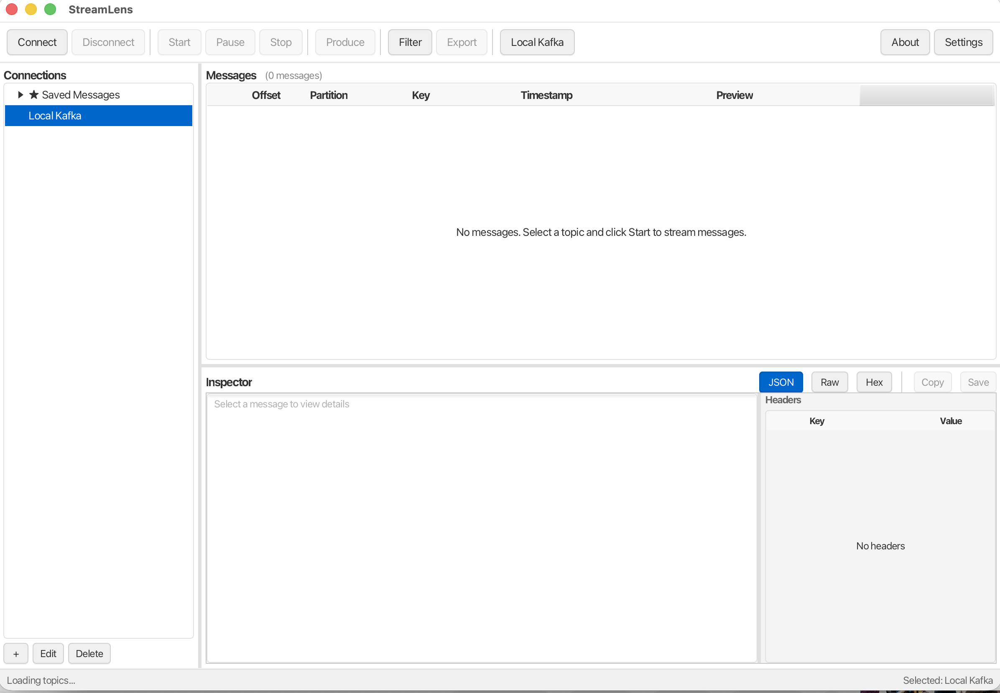

# StreamLens

A native desktop application for browsing and inspecting Apache Kafka and Azure Event Hubs messages. Built with Java, JavaFX, and Spring Boot.

<p align="center">
  
</p>

## Features

- **Multi-Platform Support** - Connect to Apache Kafka and Azure Event Hubs
- **Real-Time Streaming** - Stream messages live with start/pause/stop controls
- **Message Inspector** - View messages in JSON (pretty-printed), Raw, or Hex format
- **Powerful Filtering** - Filter by quick search, key pattern (regex), JSONPath, or time range
- **Save Filter Presets** - Save and reuse filter configurations
- **Message Persistence** - Star/flag important messages and save them locally
- **Export Options** - Export messages to JSON, NDJSON, or CSV
- **Local Kafka Server** - Built-in Docker-based local Kafka for development
- **Consumer Group Management** - View lag, reset offsets, create consumer groups
- **Message Producer** - Send messages to Kafka topics (single or batch)
- **Secure Connections** - Support for SASL, SSL, and Azure AD authentication
- **Local REST API** - Optional REST/WebSocket API for integration

## Download

### Pre-built Application (Recommended)

Download the latest release from the [Releases](https://github.com/robert-schmidt/streamlens/releases) page:

| File | Platform | Description |
|------|----------|-------------|
| `StreamLens-x.x.x.dmg` | macOS | Disk image with bundled JRE |
| `StreamLens-x.x.x.exe` | Windows | Executable (requires Java 21+) |
| `streamlens-x.x.x.jar` | Any | Executable JAR (requires Java 21+) |

> **macOS First Launch:** The app is not signed with an Apple Developer certificate. Right-click the app and select "Open" to bypass Gatekeeper.

### Run with Java CLI

If you have Java 21+ installed:

```bash
java -jar streamlens-1.0.0.jar
```

## Requirements

### For macOS (DMG)
- macOS 10.14+ (Mojave or later)
- No Java installation required (JRE is bundled)

### For Windows (EXE)
- Windows 10 or later
- Java 21 or later

### For JAR Version
- Java 21 or later

### For Local Kafka (Optional)
- [Docker Desktop](https://www.docker.com/products/docker-desktop/) for the built-in local Kafka server

## Usage

### Connecting to Kafka

1. Click **+** to add a new connection
2. Select **Apache Kafka** as the type
3. Enter your bootstrap servers (e.g., `localhost:9092`)
4. Configure authentication if needed (SASL/SSL)
5. Click **Test Connection** to verify
6. Click **OK** to save

### Connecting to Azure Event Hubs

1. Click **+** to add a new connection
2. Select **Azure Event Hubs** as the type
3. Enter your Event Hub namespace and name
4. Choose authentication method:
   - **Connection String** - Paste your connection string
   - **Azure AD** - Use DefaultAzureCredential
5. Click **Test Connection** to verify
6. Click **OK** to save

### Streaming Messages

1. Select a connection from the sidebar
2. Expand to see topics/partitions
3. Select a topic or partition
4. Click **Start** to begin streaming
5. Use **Pause**/**Stop** to control the stream

### Filtering Messages

1. Click **Filter** to open the filter dialog
2. Configure filters:
   - **Quick Search** - Search in key and value
   - **Key Filter** - Match key pattern (supports regex)
   - **JSONPath** - Filter by JSON field (e.g., `$.status == "error"`)
   - **Time Range** - Filter by timestamp
3. Click **Apply Filter**
4. Use the blue filter bar to see active filters or clear them

### Using Local Kafka

1. Ensure Docker Desktop is running
2. Click **Local Kafka** in the toolbar
3. Click **Start** to launch a local Kafka container
4. Create topics and consumer groups as needed
5. A "Local Kafka" connection is automatically added

## Building from Source

### Prerequisites

- Java 21 JDK ([Eclipse Temurin](https://adoptium.net/) recommended)
- Maven 3.8+
- macOS or Windows (for packaging)

### Build & Run

```bash
# Clone the repository
git clone https://github.com/robert-schmidt/streamlens.git
cd streamlens

# Build and run
mvn clean javafx:run

# Or build the JAR
mvn clean package -DskipTests
java -jar target/streamlens-1.0.0.jar
```

### Create Distribution Package

```bash
./package.sh
```

This creates:
- `target/dist/StreamLens.app` - macOS application bundle
- `target/dist/StreamLens-1.0.0.dmg` - macOS disk image
- `target/dist/StreamLens.exe` - Windows executable (when built on Windows)

## Authentication Options

### Kafka Authentication

| Method | Config Required |
|--------|-----------------|
| None | No authentication |
| SASL/PLAIN | Username + Password |
| SASL/SCRAM-SHA-256 | Username + Password |
| SASL/SCRAM-SHA-512 | Username + Password |
| SSL/TLS | Truststore + Keystore (optional) |

### Azure Event Hubs Authentication

| Method | Config Required |
|--------|-----------------|
| Connection String | Full connection string with SharedAccessKey |
| Azure AD | Uses DefaultAzureCredential (Azure CLI, env vars, managed identity) |

## Configuration

StreamLens stores configuration in `~/.streamlens/`:

```
~/.streamlens/
├── streamlens.db      # SQLite database (connections, saved messages, presets)
└── logs/              # Application logs
```

### Local API (Optional)

Enable the REST API in Settings:

```
GET  /api/messages           # Get current messages (supports filtering)
GET  /api/messages/stream    # WebSocket endpoint for live messages
```

Default port: `9876`

## Troubleshooting

### Cannot connect to Kafka
- Verify bootstrap servers are correct
- Check firewall/network access
- Ensure authentication credentials are valid
- Try connecting with `kafka-console-consumer` CLI first

### Local Kafka won't start
- Ensure Docker Desktop is running
- Check if port 9092 is already in use
- Click "Retry" in the Docker warning panel

### App won't open on macOS (Gatekeeper)
Right-click the app → "Open" → Click "Open" in the dialog

### Messages not appearing
- Check if filters are active (blue filter bar)
- Verify the topic has messages
- Try "Reset to Earliest" to read from beginning

## Project Structure

```
StreamLens/
├── pom.xml                              # Maven configuration
├── package.sh                           # Packaging script
├── README.md
└── src/main/
    ├── java/com/streamlens/
    │   ├── StreamLensApplication.java   # Main entry point
    │   ├── controller/                  # JavaFX controllers
    │   ├── service/
    │   │   ├── connection/              # Connection management
    │   │   ├── streaming/               # Kafka/Event Hubs streaming
    │   │   ├── browser/                 # Topic discovery
    │   │   ├── filter/                  # Message filtering
    │   │   ├── storage/                 # SQLite persistence
    │   │   ├── export/                  # JSON/CSV/NDJSON export
    │   │   ├── kafka/                   # Kafka admin operations
    │   │   └── api/                     # Local REST API
    │   ├── model/                       # Data models
    │   └── ui/                          # UI components
    └── resources/
        ├── application.properties
        ├── schema.sql                   # Database schema
        ├── fxml/                        # JavaFX layouts
        ├── css/                         # Stylesheets
        └── icons/
```

## Tech Stack

- **Java 21** - Language & Runtime
- **JavaFX 21** - GUI Framework
- **Spring Boot 3.2** - Dependency Injection & Configuration
- **Apache Kafka Client 3.6** - Kafka connectivity
- **Azure Event Hubs SDK 5.x** - Event Hubs connectivity
- **SQLite** - Local data persistence
- **Jackson** - JSON processing
- **JSONPath** - JSON querying
- **Maven** - Build system
- **jpackage** - Native packaging

## License

MIT License - See [LICENSE](LICENSE) file for details.

## Author

**Robert Schmidt**

- Website: [robertschmidt.dev](https://robertschmidt.dev)
- Support: [Buy me a coffee](https://buymeacoffee.com/robbschmidt)

## Contributing

Contributions are welcome! Please feel free to submit a Pull Request.

1. Fork the repository
2. Create your feature branch (`git checkout -b feature/amazing-feature`)
3. Commit your changes (`git commit -m 'Add amazing feature'`)
4. Push to the branch (`git push origin feature/amazing-feature`)
5. Open a Pull Request

---

**StreamLens** - See your streams clearly.
